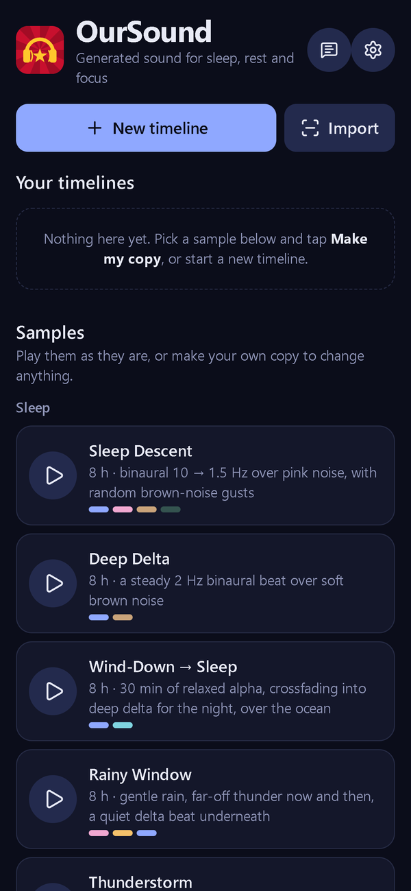
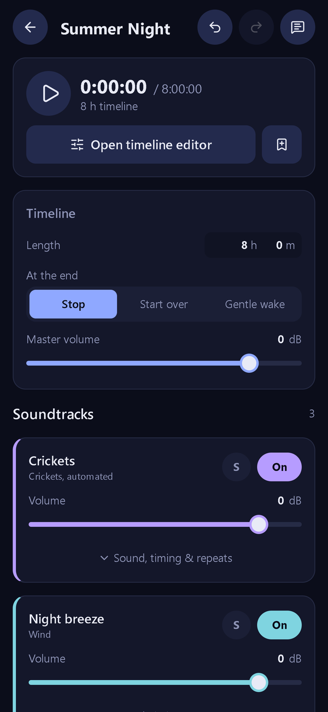
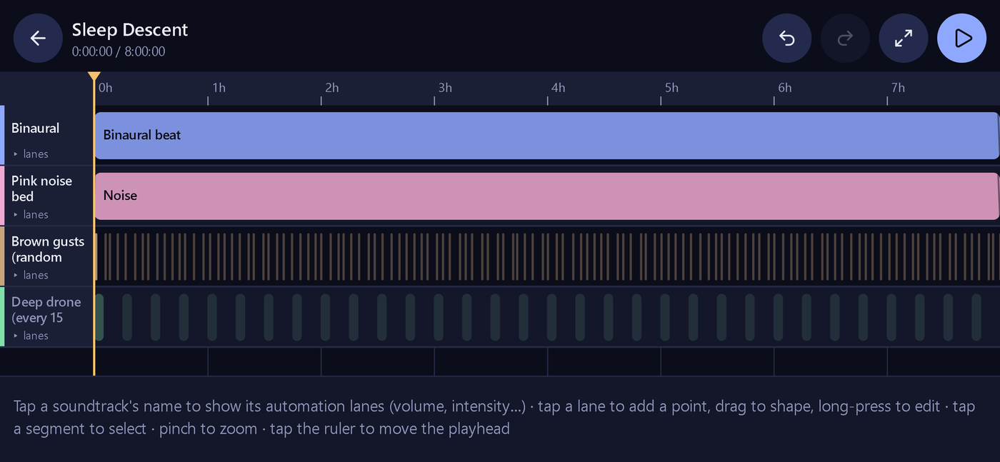

<p align="center">
  
</p>

<p align="center">
  
  
  
  
  
  
</p>

<h3 align="center">☭ Sleep audio for the people ☭</h3>

<p align="center">
  Comrade, the bourgeoisie sell you a 10-hour rain loop with a click every 47 minutes.<br>
  <b>OurSound</b> gives you the means of sound production instead.<br>
  Layer binaural beats, rain, thunder, a box fan, crickets, singing bowls and your own music
  into a timeline that runs all night. Press play, lock your phone and rest. You've earned it.
</p>

---

<p align="center">
  
  &nbsp;
  
  &nbsp;
  
  &nbsp;
  
</p>

<p align="center">
  
</p>

## ★ What the collective has built

- 🎧 **Binaural beats for every ear.** Each ear gets its own pure tone, computed in double precision with nothing in the way, so the beat stays clean all night.
- 🏭 **Every built-in sound is produced live.** The rain, fan, thunder and the rest aren't recordings or loops, so there's no seam at 3 a.m. Hour 1 and hour 3,000 cost the same memory and battery.
- 📈 **A plan for the whole night.** Drift from 10 Hz alpha down to 2 Hz delta, let the storm pass, fade the fan out by morning. Draw a curve for volume and most sound settings.
- 🔁 **Repeats without copies.** Loop a sound, play it every 15 minutes, or at random times. Thunder never rolls the same way twice.
- 💿 **Your own music.** Build an album from your own songs (MP3, M4A, WAV, FLAC, OGG…) and add a pause after each track. **Music on top** lets the background sounds fill the quiet parts.
- 🥁 **The drum pad.** Tap out your own 16-step hand-drum rhythm and slow it down through the night.
- 📤 **Distribution by QR code.** Pass a timeline to a comrade as a code: a small one fits in a single QR code, and a bigger one splits into a few that scan in any order. Imported songs don't travel; the receiver links their own copies.
- 🛡️ **Safety of the worker's ears.** A volume cap you set is enforced by a limiter on everything. Play fades in from silence (up to 30 s, your choice), and there's a sleep timer and a gentle wake.
- 🔒 **No surveillance.** No account, no ads, no tracking. Nothing leaves your phone unless you share a timeline or send feedback.

## ☭ The people's sound palette

| Department | Sounds |
|---|---|
| **Brainwave tones** | Binaural beat · Monaural beat · Isochronic tone · Pure tone |
| **Noise** | White · Pink · Brown · Green · Blue · Violet |
| **Ambience** | Box fan · Rain · Thunder · Wind · Ocean waves · Campfire · Stream · Purring cat · Crickets |
| **Music & meditation** | Ambient pad · Singing bowl · Hand drums (with drum pad) |
| **Your own audio** | Imported songs, single tracks or whole albums |

Each sound has its own controls: rain intensity, fan speed and wobble, thunder distance, bowl size and ring time, pad mood and key, and more. Most of them can follow a curve over time.

## 🌙 Collectively owned nights

47 sample timelines, free for every comrade to play as they are, or copy and change:

| Category | A few examples |
|---|---|
| **Sleep** | Sleep Descent · Deep Delta · Wind-Down → Sleep · Rainy Window · Thunderstorm · Ambient Drift |
| **Quiet room** | Quiet Bedroom · Air Conditioner · Airplane Cabin · Rain on the Roof · Snowy Night · Cat on the Bed |
| **Brainwaves** | Delta · Theta · Alpha · Beta · Gamma 40 Hz · Schumann Resonance |
| **Noise** | White · Pink · Brown · Green, plus blends and Endless Pink Noise |
| **Naps & focus** | Power Nap · Deep Focus · Meditation · Singing Bowls |
| **Ambience** | Windy Seashore · Campfire Night · Summer Night · Babbling Brook · Drum Circle |

## ⚙️ How the factory works

OurSound doesn't hoard audio, it **produces** it. Every few milliseconds of sound is worked out fresh from three things: *the time*, *the timeline's settings* and *a random seed*.

```
Timeline          the whole night (one plays at a time)
 └─ Soundtrack    a layer with its own volume, mute and solo
     └─ Segment   a block of sound: binaural, rain, fan, your MP3…
         └─ Automation   curves for any setting over time
```

- **Seeking is instant.** Oscillator phase comes from a closed-form formula, so jumping to hour 6 needs no catching up.
- **Random, but planned.** Raindrops, thunder and cricket chirps come from `hash(seed, time)`. The same moment always sounds the same, and no event lists are stored anywhere.
- **Timelines are tiny.** A whole night is just settings, a few KB of JSON, so it can be shared as a short code.
- **Two engines, one sound.** The engine is written in TypeScript and ported line by line to Java for Android's native `AudioTrack`, so it keeps playing with the screen off. Golden tests check that the two match to within 1e-4.

## 🚜 Join the workforce

**Requirements:** Node 20.19+ or 22.12+, Android Studio (SDK and platform-tools), and an Android 7.0+ phone with headphones.

```bash
npm install
```

Try it in the browser (it uses the TypeScript engine):

```bash
npm run dev
```

Build a debug APK for Android (this script calls `gradlew.bat`, so it's Windows-only; elsewhere run the same steps with `./gradlew`):

```bash
npm run android
```

Install it on a connected phone:

```bash
adb install -r android/app/build/outputs/apk/debug/app-debug.apk
```

For real overnight listening, use a release build. The native engine runs much faster than in a debug build, and the release build is signed with your local debug key so it installs directly:

```bash
npm run build && npx cap sync android && cd android && ./gradlew assembleRelease
```

### Optional: the suggestion box

The feedback button posts to a Discord-style webhook. Put its URL in `.env.local` (gitignored):

```bash
VITE_FEEDBACK_WEBHOOK=https://your.host/api/webhooks/<id>/<token>
```

Without it, the feedback button stays hidden.

## 🔬 Quality control

```bash
npm test
```

To check that the Java engine still matches the TypeScript one, render the golden files, then run the Android unit tests:

```bash
GOLDEN_DIR=android/app/src/test/resources/golden npx vitest run src/engine/golden.test.ts
```

```bash
cd android && ./gradlew testDebugUnitTest
```

## 🗂️ The central archive

```
src/
  engine/        the DSP engine: generators, automation, repeats, limiter (TypeScript)
  screens/       Library, Mixer, timeline Editor, Album, Drum pad, Settings…
  store/         zustand stores for the library and playback
  templates.ts   the sample timelines
android/
  app/src/main/java/com/oursound/app/engine/   the native Java port of the engine
PLAN.md          the Five-Year Plan: design decisions and the full progress log
```

**Built with** React 19 · TypeScript · Vite · Tailwind CSS 4 · Zustand + Immer + zundo (undo/redo) · Zod · Capacitor 8.

## 📣 Directives for restful citizens

- Wear **headphones** for binaural beats. Each ear has to hear only its own tone.
- Turn off **spatial audio / Dolby Atmos**. It mixes the ears together and smears the beat.
- Set a comfortable **maximum volume** in Settings. Nothing will ever play louder.
- Exclude OurSound from **battery optimization** so Android leaves the night shift alone.

---

<p align="center">
  <br>
  <b>Workers of the world, unwind.</b><br>
  <sub>The communism is a joke; the sleep is serious. OurSound is for relaxation and sleep, not a medical device. Brainwave entrainment effects vary from person to person.</sub>
</p>
