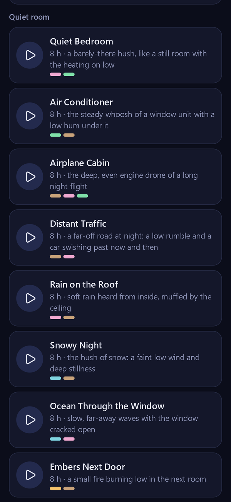
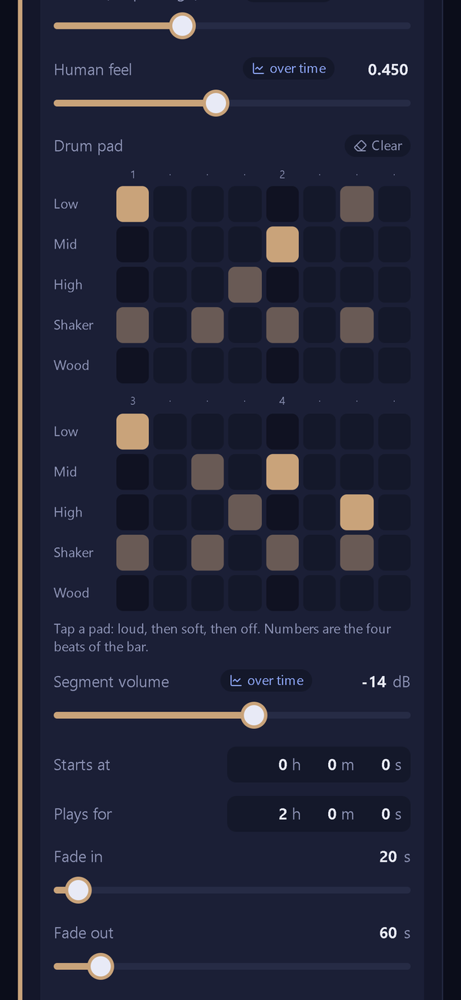

<p align="center">
  
</p>

<p align="center">
  
  
  
  
  
</p>

<p align="center">
  <b>OurSound</b> is a pocket studio for sleep sound.<br>
  Layer binaural beats, rain, thunder, a box fan, crickets, singing bowls and your own music
  into a timeline that runs all night, then press play, lock your phone and drift off.
</p>

---

<p align="center">
  
  &nbsp;
  
  &nbsp;
  
  &nbsp;
  
</p>

<p align="center">
  
</p>

## ✨ Highlights

- 🎧 **Real binaural beats.** Each ear gets its own pure tone, computed in double precision with no effects in the way, so the beat stays clean for the whole night.
- 🌧️ **Every sound is generated live.** Nothing is recorded or looped, so there's no audible seam at 3 a.m. Hour 1 and hour 3,000 cost the same memory and battery.
- 🕰️ **Timelines that change through the night.** Drift from 10 Hz alpha down to 2 Hz delta, let the storm pass, fade the fan out by morning. Draw curves for any setting.
- 🔁 **Repeats without copies.** Loop a sound, play it every 15 minutes, or at random times. Thunder rolls never come back the same way.
- 💿 **Bring your own music.** Build an album from your own MP3/M4A/WAV files, add a pause after each track, and **Music on top** lets the background sounds fill the quiet parts.
- 🥁 **Drum pad.** Tap out your own 16-step hand-drum pattern, and slow the tempo down over the night.
- 📤 **Share by QR code.** A whole 8-hour timeline fits in a QR code, because a timeline is only a few KB of settings.
- 🛡️ **Safe by design.** A volume cap you set is enforced by a limiter on everything. Every play fades in from silence, and there's a sleep timer and a gentle-wake option.
- 🔒 **Private.** No account, no ads, no tracking. Everything stays on your phone.

## 🎚️ The sound palette

| | Sounds |
|---|---|
| **Brainwave tones** | Binaural beat · Monaural beat · Isochronic tone · Pure tone |
| **Noise** | White · Pink · Brown · Green · Blue · Violet |
| **Ambience** | Box fan · Rain · Thunder · Wind · Ocean waves · Campfire · Stream · Purring cat · Crickets |
| **Music & meditation** | Ambient pad · Singing bowl · Hand drums (with drum pad) |
| **Your own audio** | Imported songs, single tracks or whole albums |

Each sound has its own controls: rain intensity and sheets, fan speed and wobble, thunder distance, bowl pitch and ring, pad mood and key, and more. Any of them can follow a curve over time.

## 🌙 Ready-made nights

Over 40 sample timelines, ready to play or copy and change:

| Category | A few examples |
|---|---|
| **Sleep** | Sleep Descent · Deep Delta · Wind-Down → Sleep · Rainy Window · Thunderstorm · Ambient Drift |
| **Quiet room** | Quiet Bedroom · Air Conditioner · Airplane Cabin · Rain on the Roof · Snowy Night · Cat on the Bed |
| **Brainwaves** | Delta · Theta · Alpha · Beta · Gamma 40 Hz · Schumann Resonance |
| **Noise** | White · Pink · Brown · Green, plus blends |
| **Naps & focus** | Power Nap · Focus · Singing Bowls |
| **Ambience** | Seashore · Campfire · Summer Night · Babbling Brook · Drum Circle |

## 🧠 How it works

OurSound doesn't store audio, it **computes** it. Every few milliseconds of sound is worked out fresh from three things: *the time*, *the timeline's settings* and *a random seed*.

```
Timeline          the whole night (one plays at a time)
 └─ Soundtrack    a layer with its own volume, mute and solo
     └─ Segment   a block of sound: binaural, rain, fan, your MP3…
         └─ Automation   curves for any setting over time
```

- **Seeking is instant.** Oscillator phase comes from a closed-form formula, so jumping to hour 6 needs no catching up.
- **Random but repeatable.** Raindrops, thunder and cricket chirps come from `hash(seed, time)`, so the same moment always sounds the same, and there are no event lists stored anywhere.
- **Timelines are tiny.** A night is a few KB of JSON, small enough to share as a QR code.
- **Two engines, one sound.** The engine is written in TypeScript and ported line by line to Java for Android's native `AudioTrack`, so it keeps playing with the screen off. Golden tests check that the two match to within 1e-4, and most sounds match sample for sample.

## 🚀 Getting started

**Requirements:** Node 22+, Android Studio (SDK and platform-tools), and an Android 7.0+ phone with headphones.

```bash
npm install
```

Try it in the browser (it uses the TypeScript engine):

```bash
npm run dev
```

Build a debug APK for Android:

```bash
npm run android
```

Install it on a connected phone:

```bash
adb install -r android/app/build/outputs/apk/debug/app-debug.apk
```

### Optional: in-app feedback

The feedback button posts to a Discord-style webhook. Put its URL in `.env.local` (gitignored):

```bash
VITE_FEEDBACK_WEBHOOK=https://your.host/api/webhooks/<id>/<token>
```

Without it, the feedback button stays hidden.

## 🧪 Tests

```bash
npm test
```

To check that the Java engine still matches the TypeScript one, render the golden files, then run the Android unit tests:

```bash
GOLDEN_DIR=android/app/src/test/resources/golden npx vitest run src/engine/golden.test.ts
```

```bash
cd android && ./gradlew testDebugUnitTest
```

## 🗂️ Project layout

```
src/
  engine/        the DSP engine: generators, automation, repeats, limiter (TypeScript)
  screens/       Library, Mixer, timeline Editor, Album, Drum pad, Settings…
  store/         zustand stores for the library and playback
  templates.ts   the sample timelines
android/
  app/src/main/java/com/oursound/app/engine/   the native Java port of the engine
PLAN.md          design decisions and the full progress log
```

**Built with** React 19 · TypeScript · Vite · Tailwind CSS 4 · Zustand + Immer + zundo (undo/redo) · Zod · Capacitor 8.

## 💡 Listening tips

- Use **headphones** for binaural beats. Each ear has to hear only its own tone.
- Turn off **spatial audio / Dolby Atmos**. It mixes the ears together and smears the beat.
- Set a comfortable **maximum volume** in Settings. Nothing will ever play louder.
- Exclude OurSound from **battery optimization** so Android leaves it alone overnight.

---

<p align="center">
  <br>
  <sub>OurSound is for relaxation and sleep, not a medical device. Brainwave entrainment effects vary from person to person.</sub>
</p>
